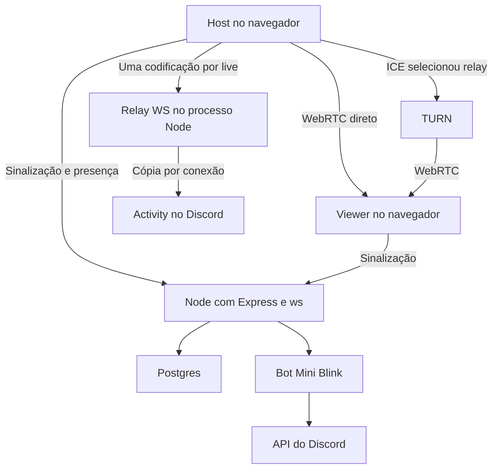
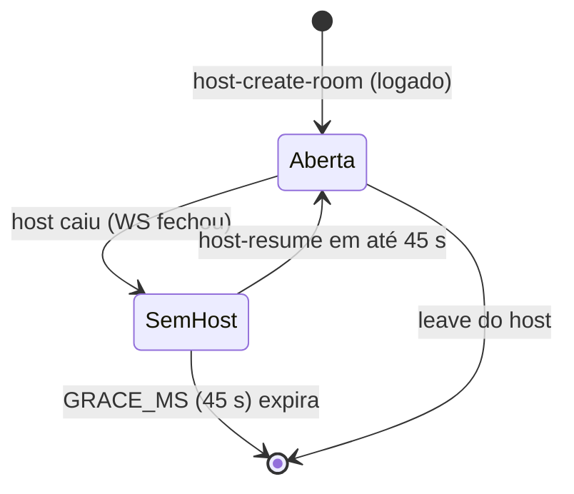
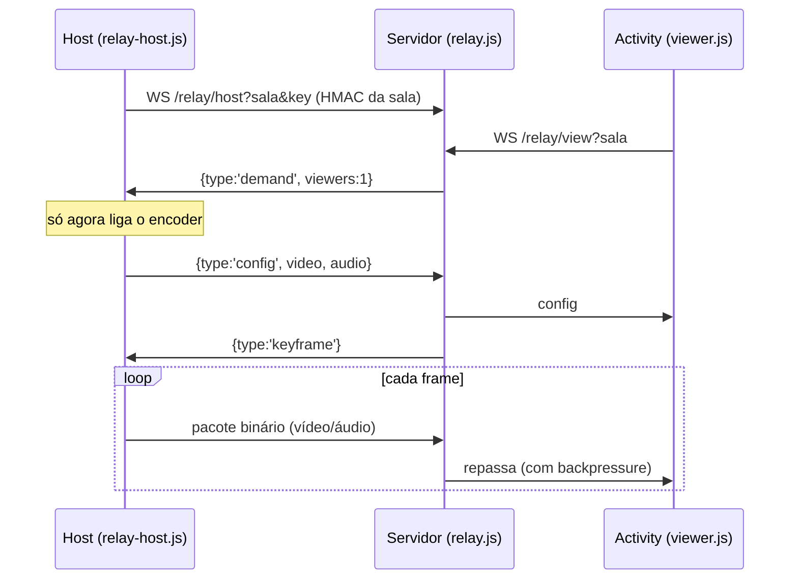

# Blink — Arquitetura

Documento técnico para quem vai manter ou evoluir o Blink. A descrição de
partida foi escrita a partir de `master` no PR #3, segundo o autor do anexo.
Esta revisão de 23/11/2026 confronta aquela descrição com a documentação
dos provedores e com os requisitos do plano. O checkout, o lockfile e a
telemetria do produto não acompanharam os arquivos. Confirmar no primeiro PR
os comportamentos descritos como existentes.

## Mapa de leitura

| Decisão | Documento de execução |
|---|---|
| Sequência de PRs e prompt inicial | [MELHORIAS.md](MELHORIAS.md) |
| Frameworks e bibliotecas | [01_ESCOLHAS_TECNICAS.md](01_ESCOLHAS_TECNICAS.md) |
| Contratos de acesso e retomada | [02_SALAS_E_ACESSO.md](02_SALAS_E_ACESSO.md) |
| Mídia no navegador e no Discord | [03_WEBRTC_DO_HOST.md](03_WEBRTC_DO_HOST.md) e [04_RELAY_E_ACTIVITY.md](04_RELAY_E_ACTIVITY.md) |
| Interface e publicação de assets | [05_FRONTEND_E_PWA.md](05_FRONTEND_E_PWA.md) |
| Persistência, contas e bot | [06_DADOS_CONTAS_E_BOT.md](06_DADOS_CONTAS_E_BOT.md) |
| Testes e operação | [07_TESTES_E_OPERACAO.md](07_TESTES_E_OPERACAO.md) |
| Receita, escala e orçamento em reais | [08_MONETIZACAO_E_ESCALA.md](08_MONETIZACAO_E_ESCALA.md) |

Os valores numéricos nas seções 4–8 descrevem a base relatada, salvo indicação
de proposta. Os contratos de atualização estão nos cadernos vinculados.

---

## 1. Resumo em um parágrafo

O Blink é um app de transmissão de tela/câmera para grupos pequenos. A mídia
trafega por **WebRTC em mesh** no navegador. Quando ICE seleciona TURN, esse
provedor também transporta a mídia. O Node cuida de autenticação, sinalização,
presença, amizades e notificações. Para quem assiste **dentro do Discord**, o
host codifica com **WebCodecs** e o Node distribui por **WebSocket**, transporte
suportado pelo proxy da Activity. Tudo roda num **único processo Node.js**
(HTTP + WebSocket + bot do Discord), com **Postgres** para estado durável e
**memória** para estado efêmero (salas). [Discord Networking](https://docs.discord.com/developers/activities/development-guides/networking)

---

## 2. Princípios de design

| Princípio | Consequência no código |
|---|---|
| **Servidor fora do caminho da mídia** | O caminho direto poupa egress de mídia no Blink. TURN e relay WS têm medidores próprios; consultar o caderno 08 para orçar. |
| **Um processo, uma porta** | `server/index.js` sobe Express, a sinalização (`ws`), o relay e o bot. Deploy em um serviço. A escala horizontal exige um dono por sala e roteamento de conexões. |
| **Estado efêmero em memória, durável no banco** | Salas (`rooms`), relay e presença vivem em `Map`s. Contas, amizades, histórico de lives e inscrições de push vivem no Postgres. |
| **Sem build no front** | `public/` é servido como está: HTML/CSS/JS ES modules. A única dependência empacotada é o SDK do Discord (`public/discord/sdk.js`, gerado por esbuild). |
| **Degradar em vez de quebrar** | Sem TURN cai para STUN; sem VAPID o push desliga; sem token do Discord o bot não sobe; sem WebCodecs a Activity manda abrir no navegador. |

---

## 3. Topologia

---

## 4. Componentes

### 4.1 HTTP (`server/src/app.js`)

Express 5. Ordem dos middlewares importa:

1. **`/api/auth/*`**: antes vem o middleware que grava `x-blink-client-ip`
   (seção 7.3); depois o handler do Better Auth, **antes** do
   `express.json()`, porque ele lê o corpo sozinho.
2. **`/api/*`**: JSON com limite de 32 KB, `Cache-Control: no-store`.
3. **Links diretos**: `/s/:code` → `/?sala=CODE`; `/@usuario` → `/?perfil=…`.
4. **Activity do Discord**: `GET /` com `?frame_id` entrega
   `public/discord/index.html` (o Discord abre a raiz do mapeamento).
5. **Estáticos** com cache longo só para imagens e fontes; HTML/CSS/JS
   revalidam sempre.

Rotas relevantes: `/api/health` (toca o banco), `/version` (não toca, usado
para manter o serviço acordado), `/api/site`, `/api/me`, `/api/ice`,
`/api/rooms/:code`, `/api/friends*`, `/api/push/*` e `/api/discord/*`.

### 4.2 Autenticação (`server/src/auth.js`)

Better Auth com adapter Drizzle.

- **Credenciais**: e-mail + senha (8–128) e login por **username** (plugin
  `username`, 3–20 `[a-z0-9_]`, que vira o link `/@usuario`).
- **Sessão**: cookie httpOnly `blink.*`, `SameSite=Lax`, 30 dias com
  renovação diária; `cookieCache` de 5 min evita ida ao banco a cada request.
- **Discord (OAuth2)**, ligado quando há `DISCORD_CLIENT_ID` + `_SECRET`:
  - **Entrar/criar conta**: conta nova ganha username gerado
    (`databaseHooks.user.create.before` → `uniqueUsername`).
  - **Vincular** a uma conta existente: só **logado** (`link-social`).
  - `disableImplicitLinking: true`: entrar pelo Discord **nunca** junta
    sozinho com uma conta de mesmo e-mail. Sem isso, um Discord com e-mail
    não verificado igual ao de outra pessoa tomaria a conta dela.
- **Rate limit**: 100 req/min geral; 10/min para sign-in; 5/min para
  sign-up, por IP (seção 7.3).

### 4.3 Dados (`server/src/db/`)

Drizzle ORM sobre `pg`. Migrations versionadas em `server/drizzle/`,
aplicadas **no boot** (`runMigrations()`), então cada deploy sobe com o
schema certo sem passo manual.

| Tabela | Papel |
|---|---|
| `user`, `session`, `account`, `verification` | Better Auth. `account` guarda credencial e vínculo com o Discord (`provider_id = 'discord'`, `account_id` = ID do usuário no Discord). |
| `friendships` | Pedido/aceite; a amizade é simétrica na leitura. |
| `live_streams` | Histórico de lives; no boot, `closeDanglingStreams()` fecha as que ficaram abertas por queda do processo. |
| `push_subscriptions` | Endpoints Web Push por usuário. |

TLS do Postgres é ligado automaticamente quando a URL tem
`sslmode=require` (Neon) ou com `PGSSL=1`.

### 4.4 Sinalização (`server/src/signaling.js`)

WebSocket na mesma porta. A sessão do Better Auth é lida **no upgrade**, a
partir do cookie: o servidor sabe quem é cada conexão e não confia em nome
ou id que o cliente diga ser.

**Mensagens do cliente**: `identify`, `host-create-room`, `host-resume`,
`viewer-join`, `viewer-resume`, `offer`, `answer`, `ice-candidate`,
`restart-ice`, `join-request`, `join-response`, `chat`, `leave` e `ping`.

**Ciclo de vida da sala**:

- **Código**: 3 bytes aleatórios em hex (6 caracteres, ~16,7 mi combinações).
- **Queda não derruba a sala**: como a mídia é P2P, o vídeo continua mesmo
  com o WebSocket caído. Host e viewers têm `GRACE_MS = 45 s` para voltar
  (`*-resume`). O anexo descreve recriação com o mesmo código após reinício. Confirmar
  como o dono é provado e como o histórico é conciliado com
  `closeDanglingStreams()`. A retomada proposta no caderno 02 usa execução,
  proprietário, geração e prazo residual persistido.
- **Heartbeat**: ping a cada 30 s; conexão sem pong é derrubada.
- **Limites**: 50 viewers por sala, nome com 24 caracteres, chat com 300,
  payload de 256 KB.
- **Privacidade**: `/s/CODE` entra direto (quem tem o código assiste). O
  `/@usuario` **nunca revela o código**: só amigo aceito pode pedir para
  entrar (`join-request`), e o host aceita ou recusa na hora.

### 4.5 Presença (`server/src/hub.js`)

Índice em memória de conexões "sociais" por usuário (uma por aba) e de quem
está ao vivo. Emite `presence`, `friend-went-live` e `friends-changed` para
os amigos, e dispara Web Push quando alguém entra ao vivo.

### 4.6 Caminho da mídia: WebRTC mesh (`public/app.js`)

- **Uma `RTCPeerConnection` por espectador**, com `bundlePolicy:
  'max-bundle'`. O host faz o offer (`offerTo`) quando o viewer entra.
- **ICE**: `/api/ice` entrega STUN sempre e TURN (Cloudflare Realtime)
  quando configurado, com credencial temporária de 6 h, cacheada até a metade
  da validade, e porta 53 removida. TURN só para quem está logado ou tem o
  código de uma sala aberta, para não virar relay grátis.
- **Perfis de qualidade** (`QUALITY`):

  | Perfil | `contentHint` | FPS | `degradationPreference` | Teto/viewer |
  |---|---|---|---|---|
  | Jogo ou vídeo | `motion` | 60 | `maintain-framerate` | 6 Mbps |
  | Texto ou código | `detail` | 30 | `maintain-resolution` | 4 Mbps |
  | Câmera | `motion` | 30 | `balanced` | 2,5 Mbps |

- **Orçamento de upload**: `UPLOAD_BUDGET_KBPS = 12000` dividido pelo número
  de peers, com piso de 500 kbps (`tuneSender`). Cada viewer novo reduz o
  bitrate dos outros. Com mais de 24 peers, só o piso de vídeo já excede 12 Mbps. O caderno 03 inclui reserva de áudio/relay e uma regra que cabe no orçamento.
- **Troca de fonte** (tela ↔ câmera) usa `replaceTrack`. O caso compatível preserva o peer; mudança fora do envelope negociado pode exigir renegociação. [MDN](https://developer.mozilla.org/en-US/docs/Web/API/RTCRtpSender/replaceTrack)
- **Captura**: `getDisplayMedia` com no máximo 1080p, áudio sem
  cancelamento de eco nem supressão de ruído (estragam música/jogo),
  `systemAudio: 'include'` e `selfBrowserSurface: 'exclude'`.

### 4.7 Relay para o Discord (`server/src/relay.js` + `public/relay-host.js`)

Motivo: a documentação de networking das Activities diz *"WebRTC is not
supported"*; o proxy delas (Cloudflare Workers) aceita **HTTPS e WebSocket**.

- **Codificação sob demanda**: o host só codifica enquanto `demand > 0`.
  Com zero viewers no Discord, o encoder pode parar. Conexões de controle e infraestrutura ainda têm custo.
- **Captura em segundo plano.** O caminho relatado usa
  `MediaStreamTrackProcessor`. Verificar sua exposição em janela ou worker
  e medir continuidade de frames com a aba oculta nos clientes suportados.
  [MDN](https://developer.mozilla.org/en-US/docs/Web/API/MediaStreamTrackProcessor)
- **Codec**: H.264 baseline (`avc1.42E01F`, Annex B) primeiro, como
  primeira tentativa, seguido por VP8 e VP9. Consultar capacidades reais do
  encoder e decoder por configuração, inclusive em aparelho móvel. [WebCodecs](https://www.w3.org/TR/webcodecs/) Áudio em Opus 96 kbps.
- **Saída**: até 1280×720, 30 fps, 2 Mbps; keyframe a cada 2 s ou sob pedido.
- **Formato do pacote**: `[tipo:1][flags:1][timestamp µs float64 BE:8][dados]`.
- **Backpressure por viewer**: acima de 1,5 MB em buffer, descarta vídeo até
  o próximo keyframe e pede um; acima de 8 MB, derruba a conexão. O áudio
  continua passando até o limite de desconexão.
- **Autorização**: publicar exige `key = HMAC(authSecret, "relay:"+código)`,
  entregue só ao host pela sinalização. Na base descrita, essa chave é estável para o mesmo código e segredo. A proposta usa ticket vinculado à execução e à geração.
- **Limites**: 20 viewers por sala; pacote do host até 1 MB.

### 4.8 Mini Blink: bot do Discord (`mini-blink/`, `server/src/minibot.js`)

- Roda **dentro do processo do Blink** quando `DISCORD_TOKEN` existe
  (`startBot()`), ou sozinho com `npm start`. Só a intent `Guilds`, sem
  intents privilegiadas.
- **`/live`** e o botão **"Mandar no Discord"** compartilham `publish()`:
  postam o anúncio, ligam canal → sala no Blink e passam a acompanhar a sala.
  A cada 20 s o bot consulta `/api/rooms/:code`; são necessárias 2 respostas
  "fechada" seguidas para encerrar (evita encerrar por um soluço). Anúncios
  com mais de 12 h encerram sozinhos.
- **Abrir a Activity**: o botão responde com `LAUNCH_ACTIVITY` (tipo 12) e
  recebe o `activity_instance.id`; o bot registra instância → sala em
  `/api/discord/link` (com `MINI_BLINK_SECRET`).
- **Qual sala a Activity abre**, em ordem: `?sala`, `custom_id`, instância,
  canal e, por último, digitar o código.
- **Persistência**: `mini-blink/data/lives.json` (escrita atômica via
  rename). No Render o disco é efêmero e o arquivo se perde no redeploy.
- **Manter acordado**: no Render, o processo acessa o próprio `/version` a
  cada 10 min. Como `/version` não toca o banco, o Neon pode dormir.

### 4.9 PWA e push (`public/sw.js`, `server/src/push.js`)

Service worker com cache de estáticos, `push` e `notificationclick`. Web
Push via VAPID, desligado sem as chaves. No iPhone só funciona com o app
instalado na tela inicial.

---

## 5. Deploy

| Peça | Onde | Observação |
|---|---|---|
| App | Render (Docker, plano grátis) | `Dockerfile` instala `server/` e `mini-blink/` (só produção). |
| Banco | Neon (Postgres) | Plano conforme uso e cotas vigentes. Fazer sizing com CU-h e armazenamento. [Neon](https://neon.com/docs/introduction/plans) |
| TURN | Cloudflare Realtime | Opcional. Sem ele, NAT simétrico fica em "Sintonizando…". |
| Discord | App com Bot + Activities + OAuth2 | URL mapping `/` → host do Blink; redirect `…/api/auth/callback/discord`. |
| Local | `docker compose` | `db` + `app` + túnel Cloudflare opcional (profiles `quick`/`named`). |

Variáveis: ver `.env.example` (raiz) e `mini-blink/.env.example`.

---

## 6. Limites de escala (e o que fazer quando bater neles)

| Limite | Por quê | Saída |
|---|---|---|
| **~5 viewers no navegador** | Mesh: o upload do host é dividido por N. Com 12 Mbps e 5 viewers, ~2,4 Mbps cada. | **SFU** (LiveKit, mediasoup): o host sobe uma vez e o servidor distribui. Muda o custo de banda. |
| **20 viewers no Discord** | Relay em processo, ~2 Mbps por viewer saindo do servidor. | Isolar o relay se a carga afetar o controle. Se houver SFU, prever ponte para o transporte aceito pela Activity. |
| **Uma instância só** | Salas, presença e relay são `Map`s em memória. Duas réplicas não se enxergam. | Definir propriedade, presença entre nós, fan-out, roteamento e expiração. Afinidade isolada não compartilha estado nem resolve o failover. |
| **Estado do bot em arquivo** | `lives.json` some no redeploy. | Tabela `discord_lives` no Postgres e fila com reconciliação do recibo. |
| **Plano grátis do Render** | Horas e egress têm franquias próprias por workspace; respostas WebSocket públicas entram na banda. [Render](https://render.com/docs/outbound-bandwidth) | Plano pago ou VPS quando houver uso real. |

---

## 7. Modelo de segurança

### 7.1 Segredos

| Segredo | Onde vive | Uso |
|---|---|---|
| `BETTER_AUTH_SECRET` | Render | Assina sessões e deriva a chave do relay. Obrigatório em produção. |
| `MINI_BLINK_SECRET` | Render (+ bot, se separado) | Bot → `/api/discord/link`. Comparado em tempo constante. |
| `DISCORD_TOKEN`, `DISCORD_CLIENT_SECRET` | Render | Bot e OAuth. |
| TURN / VAPID | Render | Nunca chegam ao front: o front recebe só o resultado de `/api/ice` e a chave **pública** VAPID. |

### 7.2 Superfícies e defesas

- **Origem do WebSocket**: o upgrade recusa origens fora de `PUBLIC_URL` /
  `TRUSTED_ORIGINS`. Exceção consciente: `/relay/view`, que é só leitura e
  pede o código da sala, aceita a origem do proxy do Discord.
- **Publicar no relay**: exige o HMAC da sala.
- **Contas**: sem vínculo implícito pelo Discord (seção 4.2).
- **TURN**: só para logado ou para quem tem o código de uma sala aberta.

### 7.3 IP do cliente e rate limit

Atrás do Render, o `X-Forwarded-For` **não é limpo**, só acrescido; o começo
da lista é do visitante. O app grava `x-blink-client-ip` a partir de:

1. `CLIENT_IP_HEADER`: no Render, por padrão `cf-connecting-ip`, conforme a topologia descrita pelo autor. Validar se o caminho real garante a origem do header e impede ingresso por caminhos alternativos;
2. senão, `req.ip` do Express com `trust proxy = 1`, o último salto.

O Better Auth lê só esse cabeçalho (`advanced.ipAddress.ipAddressHeaders`).

### 7.4 Riscos conhecidos (aceitos ou pendentes)

- **Sem CSP nem cabeçalhos de endurecimento** (`helmet` ou equivalente).
- **`/api/rooms/:code` e `/api/discord/room?channel=` não têm rate limit**:
  permitem descobrir códigos abertos por força bruta e obter o código de uma
  sala a partir do ID de um canal.
- **O código da sala é a única credencial do link `/s/`**: é um link de
  convite por desenho, não uma sala privada.

---

## 8. Observabilidade e testes

- **Logs**: `console.*` no stdout do Render. Não há métricas nem tracing.
- **Saúde**: `/api/health` (testa o banco e informa se TURN e push estão
  configurados) e `/version` (commit + horário do boot, sem banco).
- **Testes automatizados**: só o bot (`mini-blink`, `node --test`). O
  servidor e o front não têm suíte. A validação foi feita com roteiros
  Playwright ad-hoc (WebRTC, relay, áudio, rate limit) que **não estão no
  repositório**.

---

## 9. Decisões registradas

| Decisão | Alternativa descartada | Motivo |
|---|---|---|
| Mesh P2P | SFU desde o início | Custo zero e simplicidade para grupos de amigos. |
| Processo único | Microserviços | Hospedagem grátis e deploy trivial. |
| Relay WebCodecs + WS só para o Discord | HLS de baixa latência | Reutiliza o WS aceito pelo proxy. O valor de ~0,3 s citado na decisão original carece de medição reproduzível. |
| WebCodecs no viewer | MSE | O primeiro caminho usa decoder por codec. Registrar capacidades e resultados por versão do cliente Discord/iOS antes de atribuir suporte a uma plataforma inteira. |
| Neon para o banco | Postgres do Render | Decisão histórica de hospedagem; rever franquias e custo real conforme uso. |
| Bot dentro do Blink | Serviço separado | O processo único reduz compute inicial. Isolar o relay ou o bot quando observabilidade e orçamento justificarem. |

## 10. Correções que afetam a próxima implementação

| Premissa histórica | Consequência no projeto revisado |
|---|---|
| Código de sala, `channel_id` e `instance_id` podem aparecer em links ou no cliente. | O convite explícito autoriza o viewer; o resolvedor automático da Activity verifica identidade e participação no Discord. `runId` distingue duas transmissões que usaram o mesmo código. [API Discord](https://docs.discord.com/developers/resources/application#get-application-activity-instance) |
| O servidor fica fora da mídia no caminho P2P direto. | O upload do host é por peer. O relay Discord consome uma cópia do host e uma saída do Render por viewer; dimensionar CPU, memória e GB separadamente. |
| Ativar o segundo decoder é uma atualização pequena. | Configuração tem estado por trilha. Um pacote de áudio não reinicia o vídeo. Após descongestionamento, só o keyframe compatível recupera o leitor. |
| Reescrever HTML/JS de produção altera URLs que a PWA guarda. | Manifesto versionado, compatibilidade com a release anterior e SW em espera protegem lives abertas. |
| Persistir no boot bastaria para o bot acompanhar lives. | O recibo de uma chamada ao Discord pode se perder entre a API e o commit. A fila precisa distinguir envio incerto, fechamento confirmado e reprocessamento. |
| Escala acompanha o total de cadastros. | O orçamento usa horas-espectador por caminho, pico simultâneo e bitrate. Os cenários e as tarifas estão no [caderno financeiro](08_MONETIZACAO_E_ESCALA.md). |
